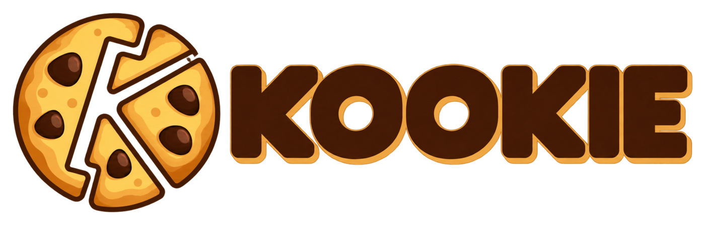
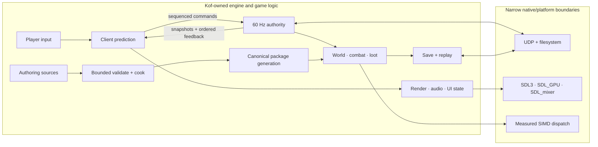

<p align="center">
  
</p>

<p align="center">
  <a href="https://github.com/rufl/KOOKIE/actions/workflows/verify.yml"></a>
  <a href="https://github.com/rufl/KOOKIE/releases"></a>
  
  <a href="LICENSE"></a>
  
</p>

<p align="center">
  <strong>An experimental 3D shooter engine built around Kof.</strong><br>
  Boomer-shooter combat, ARPG structure, authoritative multiplayer and a
  fail-closed content pipeline—without a general-purpose engine behind it.
</p>

<p align="center">
  <a href="#quick-start">Quick start</a> ·
  <a href="#the-shape-of-the-engine">Architecture</a> ·
  <a href="https://github.com/rufl/KOOKIE/releases">Dogfood releases</a> ·
  <a href="docs/RUNNING_AND_PACKAGING.md">Build and package</a> ·
  <a href="pt-BR/README.md">Português (Brasil)</a>
</p>

> **Experimental, deliberately.** KOOKIE is an engine lab, not a finished game
> or a general-purpose engine. Claims below are limited to the focused probes,
> hardware and workloads that produced them.

## Start here

| If you want to… | Go here |
|---|---|
| Run the current authoritative check | [Quick start](#quick-start) |
| Download the latest public Linux artifact | [Releases](https://github.com/rufl/KOOKIE/releases) |
| Try the current lobby and player screen | [Multiplayer lobby and score screen](#multiplayer-lobby-and-score-screen) |
| Assess Windows/Linux playable-demo readiness | [Demo release readiness](docs/DEMO_RELEASE.md) |
| Understand the boundaries | [Architecture](docs/ARCHITECTURE.md) |
| Build, package or run qualification roles | [Running and packaging](docs/RUNNING_AND_PACKAGING.md) |
| See the evidence and open work | [Engine plan](docs/ENGINE_PLAN.md) and [G0 backlog](docs/G0_BACKLOG.md) |
| Change the project | [Contributing](CONTRIBUTING.md) |

## Why this exists

Most engines optimize for broad applicability. KOOKIE optimizes for inspectable
authority boundaries and claims that can be reproduced.

Portable engine, game and tool decisions stay in Kof. C owns narrow,
explicit platform boundaries: SDL3/SDL_GPU, SDL_mixer, UDP, filesystem
durability and measured SIMD dispatch. A feature is not called done because a
class or menu exists; it needs an executable path and a stated proof limit.

The result is intentionally opinionated:

- the server decides combat, loot, progression and persistence;
- clients predict presentation-safe movement, then reconcile;
- source assets cross bounded validation and canonicalization before runtime;
- malformed state, packages, saves and compatibility offers fail closed;
- release artifacts bind source and toolchain provenance with signatures.

## Quick start

### Play the published package

Packages built from the current tree contain the native Kof game, SDL3, SDL_mixer
and the cross-platform update launcher. They require neither the Kof toolchain
nor Python:

1. Download the target package from the
   [KOOKIE GitHub releases](https://github.com/rufl/KOOKIE/releases).
2. Verify `SHA256SUMS` and the detached signatures as described in
   [Running and packaging](docs/RUNNING_AND_PACKAGING.md#run-the-currently-published-linux-dogfood).
3. Extract the archive and run the updater:

```bash
./kookie-launcher
```

The launcher fetches the newest published package for Linux or Windows,
verifies its signed manifest and archive digest, updates atomically, and then
starts the game. `./kookie` remains the direct local-package wrapper.
The currently public GitHub release is Linux-only and predates this updater;
it can be run through `./kookie`. Windows packages built by the same script
include `kookie-launcher.exe` and `kookie-launcher.cmd`, which select a Windows
release when one is published.

### Run qualification from source

Install [Kof 0.6.5](https://github.com/KofLang/Kof4j) for the source
entrypoint:

Use the source-built distribution from the Kof `lab` branch at commit
`a14a7cd47d74192dcc977c9d4cbf87d407694560`. `scripts/prepare_kof_source.sh`
verifies that the upstream native GC cycle guard is present, then normalizes
the compiler metadata before Maven packaging.

To refresh the local environment from the current `lab` head, run:

```bash
bash scripts/install_kof_lab.sh
```

The installer builds the current lab commit, verifies that the mutable branch
did not move during the build, then updates the tracked pin and atomically
installs that exact commit. CI refreshes the pin every 15 minutes through
`.github/workflows/update_kof_lab.yml` and opens a PR for the normal gates. If
the mutable lab branch advances while the local build is running, the
installer exits without switching the launcher; rerun it.

```bash
git clone https://github.com/rufl/KOOKIE.git
cd KOOKIE
source scripts/kof_pin.sh
kof run src/main.kf --target native
```

`kof run` itself does not require Python. Python 3 is currently required by
repository verification, packaging, evidence-validation and rendezvous scripts
such as `scripts/verify.sh`, `scripts/package_kookie.sh` and
`scripts/kookie_rendezvous.py`.
Native SDL presentation requires `pkg-config` entries for FreeType 2 and
HarfBuzz at build time. The adapter loads the packaged TrueType files, shapes
text with HarfBuzz, rasterizes glyphs with FreeType, and decodes the shipped
SVG mark at runtime; there is no generated font atlas.

Run the focused gameplay and replay path:

```bash
bash scripts/verify_interactions.sh
```

Run the focused local goose gameplay and multiplayer lobby/score probes:

```bash
bash scripts/verify_goose_game.sh
bash scripts/verify_multiplayer_ui.sh
```

Run the non-graphical G6 expansion probes:

```bash
bash scripts/verify_g6_runtime.sh
```

Presentation package builds require SDL 3.4.18, SDL_mixer 3.2.4,
`glslc` and `spirv-val`. If `pkg-config` cannot find SDL_mixer, prepare the
pinned development prefix once:

```bash
bash scripts/bootstrap_sdl3_mixer.sh
```

The bootstrap downloads the official SDL_mixer 3.2.4 source archive, verifies
its SHA-256, builds only the bounded WAVE/stb_vorbis backends and stores the
ignored prefix under `.kookie-deps`. Exact package, kooker, Windows and
cross-host qualification commands live in [Running and packaging](docs/RUNNING_AND_PACKAGING.md).

The player entrypoint is the signed package's native update launcher:
`kookie-launcher` on Linux and `kookie-launcher.exe`/`kookie-launcher.cmd` on
Windows. It queries the latest published target package from the KOOKIE GitHub
release API on each normal start, verifies the embedded Ed25519 manifest
signature and archive SHA-256, stages/extracts safely, then launches the game.
It requires neither Kof nor Python. Use `--check`, `--offline` or
`--self-test` for non-launching operation; see
[Running and packaging](docs/RUNNING_AND_PACKAGING.md) for state paths,
fallback behavior and the focused updater smoke test.

## Multiplayer lobby and score screen

The Kof-owned multiplayer screen keeps the session contract small and
inspectable: fixed two-player admission, host/join/waiting/connected/ready/
failed phases, room identity, bounded player names, peer count, ping display
and visible transport errors. It is a session card, not an unbounded
master-server browser. Gameplay remains locked while either player is not
ready; the `READY` action is explicit and the session opens only after both
connected players confirm.

During gameplay, `Tab` toggles a deterministic player screen with player name,
score, health, kills/deaths, ping and live/ready/disconnected status. The host
publishes a checksummed bounded scoreboard snapshot; clients validate the
whole message, reject stale sequences and rank ties by score, kills, deaths
and stable player ID. A displayed `--` ping means RTT measurement is not yet
available; it is not a fabricated latency value.

The focused model and staging proof is:

```bash
bash scripts/verify_multiplayer_ui.sh
```


## Current demo and release status

The latest published dogfood artifact recorded by this repository is
[`0.1.0-dogfood.38`](https://github.com/rufl/KOOKIE/releases/tag/0.1.0-dogfood.38),
built from source commit `a86d55eddb0aae2f0a7e05fb59033560d34c95c7`. That
record is historical relative to the current checkout. For every new
candidate, `RELEASE_QUALIFICATION.json` is the signed authority: deterministic
artifact gates may pass while target-hardware presentation evidence remains
required for `releaseEligible=true`.

The current source tree has a bounded player-facing slice:

The player-facing test game is branded **GatoGanso**. Its bounded native
presentation uses bundled `Pixand` body text and `Jared Lite` display text;
the original TTF files and SIL Open Font License notice remain in
`assets/fonts`.

- `Play` starts the local authoritative listen-server/client encounter,
  accepts keyboard and mouse input, runs three goose bots and resets when
  leaving and entering `Play` again.
- `Multiplayer > Host/Join` admits the second player through the KOF-owned
  lobby, requires both connected players to select `READY`, and publishes the
  deterministic `Tab` scoreboard with player, status, score, HP, K/D and ping.
- The session path uses fixed-tick input bundles with snapshot/input ACKs,
  authenticated peer pinning, a bounded 12-tick hitscan rewind window, six-tick
  remote interpolation and prediction-correction metrics. The WAN path remains
  best-effort direct IPv4/UDP rather than a QUIC-compatible or production
  relay service.
The prototype liquid slice is data-driven: `assets/prototype/runtime/liquid_physics.json`
controls underwater movement and O2 rates; `runtime/water_bodies/*.json` defines
surface bounds, tint, caustics, toon contrast/opacity and splash timing;
`runtime/floatables/*.json` selects per-object buoyancy, density, drag and
gravity; and `runtime/power_ups/*.json` defines coffee mugs, jetpacks,
megaphones, scuba kits and watermelons with bounded pickup positions, durations
and effect values. Native gameplay stages the water marker surfaces, toon splash
geometry, floating objects, power-up diamonds and the active power-up HUD panel
from those bounded definitions. Coffee mugs increase movement speed, jetpacks
increase jump impulse, megaphones increase damage, scuba kits reduce underwater
O2 drain and watermelons restore health. The JVM suite covers JSON loading,
underwater movement, oxygen recovery, buoyancy, pickup effects and splash
expiry; native SDL_GPU presentation remains subject to the host's
driver/dependency gate.

The 2026-10-02 GUI pass adds a consistent framed shell, selected-row rails,
screen-specific subtitles, bounded text clipping and explicit keyboard hints
across the main, options, multiplayer, accessibility and Kutter screens. The
main menu now exposes `Play`, `Multiplayer`, `Options`, `Accessibility`, `Kutter`
and `Quit`. Accessibility cycles HUD scale (`85%`, `100%`, `115%`), tactical-map
visibility and high-contrast text; scale and map changes apply to the live
presentation without changing fixed vertex budgets. The round upper-right map
keeps the DINX/ZYLVE-inspired flexibility goal without copying either product.
The focused `bash scripts/verify_multiplayer_ui.sh` probe stages five shell
frames in both JVM and native paths; `bash scripts/verify_font_ui.sh` covers the
font/title contract; [`docs/UI_LIBRARY.md`](docs/UI_LIBRARY.md) documents the
internal Kof/KofJS SVG/PNG, typography and sound-cue facade;
`bash scripts/verify_ui_library.sh` checks the reusable Kof/KofScript contracts;
`bash scripts/verify_ui_sound_catalog.sh` checks all 14 native source/digest
publication tuples and the bounded spatial FIFO; and
`bash scripts/verify_ui_demo.sh` builds the isolated KofJS UI demo and checks
the published asset manifest. The sound-cue adapter keeps `.ogg`/`.wav`
descriptor metadata separate from the bounded native queue and applies
registered UI spatial gains in SDL_mixer. The 14 supplied JDSherbert OGG files
remain license-blocked for redistribution until provenance is confirmed.
[`docs/KOF4J_UI_MIGRATION.md`](docs/KOF4J_UI_MIGRATION.md) records the current
Kof4j `0.6.5` UI/FFI boundary. The synchronous `Buffer(U8)` qualification
passes on JVM and native x86-64 with the active pin; cross support remains
unqualified and `Buffer(U8)` is not a portable typed/asynchronous upload ABI.
`bash scripts/verify_package.sh` validates the `none` package profile and
`bash scripts/verify_prototype_package.sh` validates the `prototype` profile;
`bash scripts/verify_goose_game.sh` covers the bounded gameplay path. The
retained G5 Linux x86-64 qualification records the 4 ms/tick timing contract,
30-minute soak, resource plateau and 984-instance renderer batch; it does not
claim arbitrary population, another OS/GPU, WAN scale or streaming.

The latest local paired qualification was built from source commit
`69b16d9312ebe6b86c34fda1f665ad1b8665558b`:

- Linux `0.1.0-linux-e2e.3`, archive SHA-256
  `d35443f514e7a21c3bfd1dadb170c76658944959de37b99084070a9908191cb1`.
- Windows `0.1.0-windows-e2e.3`, archive SHA-256
  `c6d80779f960339752bfa8a5848b515f46827ddfc11a3e3cfd788e5e81dce7f6`.

Both passed deterministic duplicate builds, detached signatures, checksums,
safe extraction, and target package qualification. The package manifests
record Kof source `bf17ac7e736471c8a04b4153e5b0f607be75e70c`; these were
qualification-only artifacts signed with an ephemeral key, not public releases.

The current host cannot close target presentation gates: isolated Linux
presentation exits `124` because DRI3/SDL_GPU is unavailable, and isolated
Wine exits `70` for the same missing SDL_GPU backend. Native Windows hardware
presentation and fresh target-host Play/restart/quit evidence remain open.
The same host measured dedicated-server p95 at `6.9 ms` against the declared
`4 ms` budget; the budget was not relaxed.

| Target | Qualified now | Remaining release evidence |
|---|---|---|
| Linux x86-64 | Deterministic signed package, extraction, package smoke, gameplay/package provenance | Fresh supported-GPU Play/movement/look/fire/damage/restart/quit smoke, screenshot, driver and exit evidence; current host also needs the 4 ms timing gate |
| Windows x86-64 | Deterministic signed PE/SDL/SPIR-V/DXIL package | Native Windows input/audio/GPU/driver presentation smoke and paired release evidence |


The detailed acceptance checklist, release blockers and non-blocking future
scope are in [Demo release readiness](docs/DEMO_RELEASE.md).

## What works today

| Area | Implemented bounded path |
|---|---|
| **Authority and networking** | 60 Hz server/client sessions, two-client admission, authenticated compatibility handshake, fixed-tick input bundles with bounded redundancy and ACKs, pinned peer endpoints, 12-tick hitscan rewind, six-tick remote interpolation, prediction/reconciliation metrics, reconnect and replay/tamper rejection; bounded direct-IPv4 WAN rendezvous with best-effort UDP hole punching; Kof-owned lobby and checksummed two-player scoreboard state |
| **Player-facing slice** | Local `Play` runs the bounded authoritative goose encounter; Host/Join adds explicit two-player ready gating; `Tab` exposes the host-authoritative player screen. Fresh clean-tree package smoke and native hardware evidence remain release gates. |
| **Shooter and ARPG systems** | Hitscan/projectile/shotgun combat, enemy roles, deterministic loot, inventory, equipment, skills, status effects, bosses, rewards and exactly-once progression |
| **World and presentation** | True 3D authored arena with slopes, steps and stacked rooms; capsule/triangle collision; doors, secrets and exits; semantic HUD; SDL_GPU instancing; positional gain/pan through SDL_mixer |
| **Content and kutter tooling** | Bounded GLB, Dust3D, Aseprite, VOX, Quake-style brush, Blockbench, PNG, SVG/SVGZ and WAV intake; canonical products; `.kpkg` validation; transactional Kutter edits; persistent Kutter hierarchy/transform/asset registry |
| **Persistence and release** | Checksummed replay, schema migrations, crash-durable save publication, signed clean-tree packages, dependency closure and outside-checkout smoke |
| **Runtime targets** | Authoritative native Linux x86-64; native Windows Kof PE gameplay linked to SDL3/SDL_mixer shell; native Windows Kof PE SDL_GPU presentation with SPIR-V/DXIL products; separate reproducible Windows Kof JVM compatibility package; deterministic reachable Kof-to-AMD64 PE/COFF compiler |

## The shape of the engine



Kof owns decisions. Native code owns explicit ABI and platform boundaries.
Presentation consumes authoritative state; it does not award damage, loot or
progression. See [Architecture](docs/ARCHITECTURE.md) for the full contracts.

## Engineering evidence

These numbers describe exact retained qualification workloads—not general
performance claims.

| Evidence | Recorded result | Boundary |
|---|---:|---|
| Authoritative session | 60 Hz, host + two clients | Same-host process qualification; G4 also passed across three isolated Linux network namespaces |
| G5 simulation soak | p95 **3.202 ms/tick**; RSS within **128 KiB** after warm-up | 30 minutes on one Linux x86-64 workstation; 64 enemies, 256 projectiles, 512 pickups, 24 lights, 64 effects |
| SDL_GPU reference scene | **984** hardware triangle instances in **one draw**; p95 submission **0.645 ms** | 600 frames at 1920×1080 on recorded Intel Arrow Lake graphics |
| Kof buffer SIMD probe | 64 MiB batch: scalar **233.350 ms**, AVX2 **1.074 ms** | Exact reduction ABI/workload only; not a gameplay-wide speedup claim |
| Release chain | Ed25519-signed archive, manifest and checksum set | Clean source tree, pinned Kof source and verified distribution digest required |

## Content that crosses the boundary

The kooker accepts documented subsets rather than claiming general format
compatibility:

`GLB` · `Dust3D` · `Aseprite` · `VOX` · `MAP` · `Blockbench` · `PNG` · `WAV` · `OGG Vorbis` · `SVG` · `SVGZ`

It emits bounded canonical geometry/collision, RGBA8 images/atlases, `KCHR`
characters, fixed-point `SVGC` vector products, PCM16 audio, byte-preserving
OGG Vorbis tracks and package-ready checksums. Products are reopened and
validated before atomic publication; failed imports keep the prior generation
active.

```bash
scripts/kooker.sh cook blockbench character.bbmodel character.kchar
scripts/kooker.sh cook png texture.png texture.rgba.png
scripts/kooker.sh cook wav effect.wav effect.pcm16.wav
scripts/kooker.sh cook ogg theme.ogg theme.canonical.ogg
scripts/kooker.sh cook svg icon.svg icon.svgc
scripts/kooker.sh cook svgz icon.svgz icon.svgc
```

Limits are part of the contract, not temporary documentation omissions. See
[Additional intake hardening](docs/ARCHITECTURE.md#additional-intake-hardening)
for the production work still open.

## Honest boundaries

- Transport evidence now includes the bounded direct-IPv4 authenticated endpoint
  and a deterministic fixed-window/retry channel; it is not a fresh
  three-physical-machine qualification bundle and does not claim NAT traversal,
  relay service, confidentiality or DDoS resistance.
- Linux x86-64 remains the authoritative native Kof gameplay target. Windows now
  has qualified native Kof PE gameplay in both the SDL shell and SDL_GPU
  presentation package; the separate JVM package is compatibility-only.
  Optional isolated Wine smoke remains environment-gated and target/GPU
  specific.
- Importers support small, explicit profiles—not arbitrary files from each
  named format.
- Live reload covers validated scene/render products, not arbitrary Kof code,
  shaders, editor plugins or unbounded streaming.
- Rich authoring beyond the bounded persistent Kutter, broader OS/GPU coverage,
  streamed audio, codecs outside the bounded OGG Vorbis/WAVE set, HRTF/EFX and
  a general-purpose sandboxed extension API remain unfinished.

If a claim lacks a focused test or probe, it is not presented as complete.

## Repository map

| Path | Purpose |
|---|---|
| [`src/`](src/) | Kof-owned engine, game, session, content and UI logic |
| [`native/`](native/) | Narrow SDL, transport, persistence and SIMD adapters |
| [`apps/`](apps/) | Packaged server, kooker, SIMD benchmark and platform tools |
| [`probes/`](probes/) | Focused executable evidence at risky boundaries |
| [`scripts/`](scripts/) | Verification, packaging and qualification automation |
| [`docs/`](docs/) | Architecture, plans, language notes and research evidence |

## Documentation

- [Architecture](docs/ARCHITECTURE.md) — authority, data flow and runtime
  boundaries.
- [Engine plan](docs/ENGINE_PLAN.md) — gate definitions, measurements and
  deferred scope.
- [Running and packaging](docs/RUNNING_AND_PACKAGING.md) — developer,
  release, kooker and qualification commands.
- [Kof language notes](docs/KOF_LANGUAGE.md) — syntax, targets, FFI and runtime
  findings.
- [UI library](docs/UI_LIBRARY.md) — reusable layout, widgets, typography,
  assets, icons and sound-cue contracts.
- [Kof4j UI/ABI migration](docs/KOF4J_UI_MIGRATION.md) — upstream boundary,
  buffer evidence and contribution path.
- [Executed probes](docs/RESEARCH_PROBES.md) — commands, results and proof
  limits.
- [Changelog](CHANGELOG.md) — recent behavior changes.
- [Project memory](MEMORY.md) — current decisions, caveats and next action.

Public documentation is mirrored in
[Brazilian Portuguese](pt-BR/README.md).

## Contributing

Read [CONTRIBUTING.md](CONTRIBUTING.md) before changing dependencies,
authority boundaries or qualification claims. During development, run the
smallest focused check that proves the change. The complete gate is:

The gate's package checks require `KOOKIE_KOF_ARCHIVE` to point to the exact
Kof distribution used by `kof`, with `KOOKIE_KOF_ARCHIVE_SHA256` and
`KOOKIE_KOF_SOURCE_COMMIT` set to its verified identity.

```bash
bash scripts/verify.sh
```

Graphical checks must use the repository's reviewed isolated-display contract;
never target an active desktop or physical monitor. Security-sensitive findings
belong in the [private reporting path](SECURITY.md), not a public issue.

## License and provenance

KOOKIE is [MIT licensed](LICENSE). Native distributed runtime dependencies are
SDL 3.4.18 and SDL_mixer 3.2.4 under the zlib License. The optional Windows JVM
profile bundles one SHA-256-pinned OpenJDK runtime under its own licenses and
preserves `runtime/legal` and `runtime/NOTICE`. Exact sources and boundaries are
recorded in [THIRD_PARTY_NOTICES.txt](THIRD_PARTY_NOTICES.txt).

The Kof compiler remains an external build tool and is not distributed. Only
the explicit Windows JVM profile bundles Java; its provenance records the
runtime vendor, version and archive digest.
