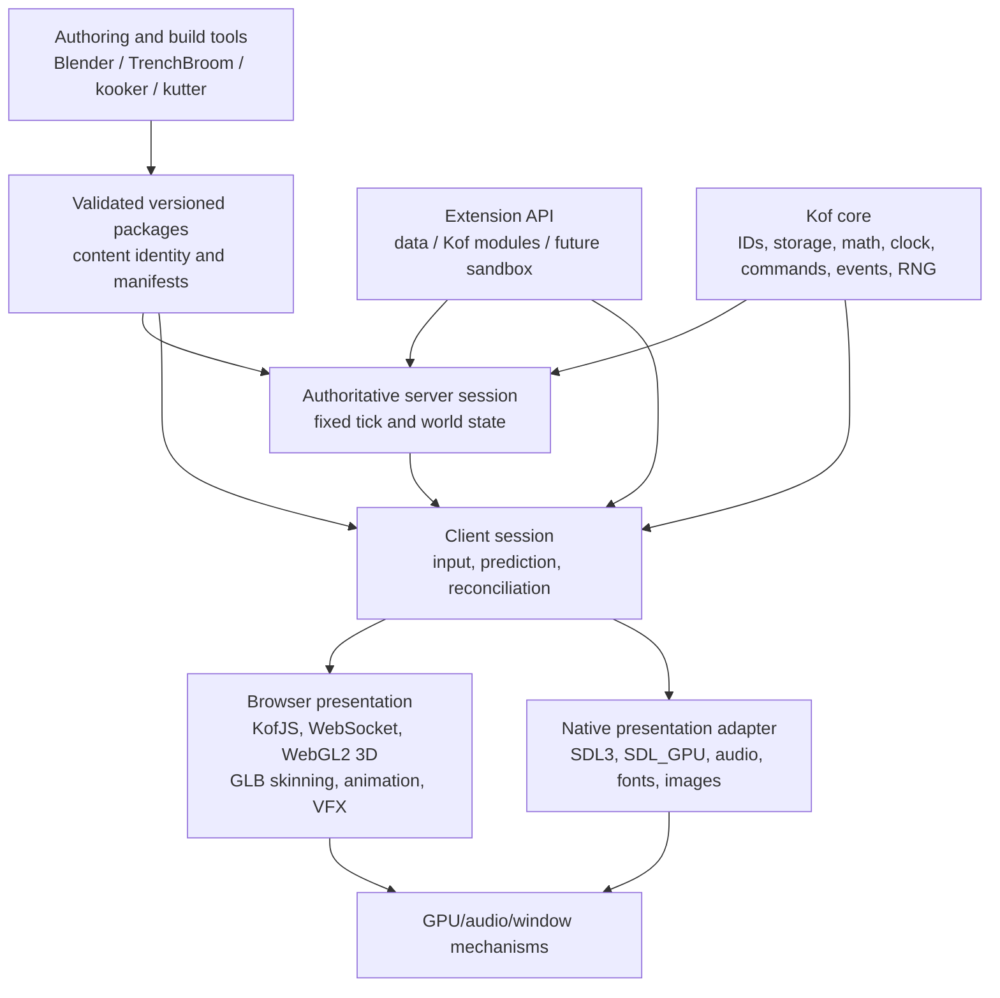
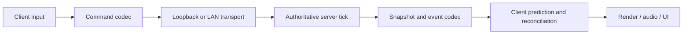

# KOOKIE project architecture

Status: **living target architecture; the bounded G0–G6 implementation is complete within the documented qualification limits**.


This document is the project-level architecture authority. Detailed acceptance
experiments remain in [ENGINE_PLAN.md](ENGINE_PLAN.md).

## 1. Product boundary

KOOKIE is a true-3D, multiplayer-first, content-driven FPS engine supporting
boomer-shooter, looter-shooter and ARPG-FPS rulesets on one simulation and
content foundation.

Every play is a network session:

- Single-player is a local listen server plus a local client over serialized
  loopback transport.
- LAN play is a host server plus local and remote clients.
- Dedicated play is a headless server plus remote clients.

There is no privileged offline simulation path.

## 2. Architectural decisions

1. **Modular monolith:** one Kof runtime, one authoritative simulation, static
   modules, no dynamic plugin ABI initially.
2. **Server authority:** the server owns simulation, persistence, RNG, combat,
   inventory, progression, world generation and extension authority.
3. **Kof ownership:** engine-owned CPU behavior stays in `.kf`.
4. **Thin native boundary:** native code adapts SDL/GPU/audio/font/image
   mechanisms; it does not own gameplay or scene algorithms.
5. **Stable extension API:** public extensions use versioned IDs, queries,
   commands, events, registries and snapshots rather than internal arrays.
6. **Data first:** content packages are validated, versioned, namespaced and
   atomically published before runtime admission.
7. **Bounded behavior:** queues, memory, packet sizes, entity counts, script
   work and extension effects have explicit limits and failure outcomes.
8. **No hidden authority:** renderer, client, editor, audio and mods cannot
   silently mutate authoritative server state.

### Measured source composition

`scripts/report_code_mix.py` measures physical source lines in the current
working tree under `src`, `probes`, `apps`, `native`, `scripts` and `tooling`.
The report includes untracked source files and excludes generated build output.
Current result:

| Group | Files | Lines | Share |
|---|---:|---:|---:|
| Kof (`.kf`) | 170 | 83,128 | 77.89% |
| KofScript (`.ks`) | 4 | 764 | 0.72% |
| C/header (`.c`, `.h`) | 17 | 8,660 | 8.11% |
| Shell tooling (`.sh`) | 55 | 8,103 | 7.59% |
| Python tooling (`.py`) | 21 | 4,346 | 4.07% |
| PE bridge Java (`.java`) | 1 | 1,504 | 1.41% |
| GPU shaders | 8 | 215 | 0.20% |
| **Total** | **276** | **106,720** | **100%** |

The runtime slice (Kof/KofScript/C/shaders, excluding build tooling and the PE
bridge) is 92,767 lines: Kof 89.61%, KofScript 0.82%, C/header 9.34% and
shaders 0.23%. This is a composition measure, not a performance claim.

Do not translate code only to increase the Kof percentage. Keep SDL/SDL_GPU,
SDL_mixer, Winsock, filesystem durability, thread scheduling, SIMD intrinsics,
shader source and buffer/pointer marshalling native. KofScript remains the
bounded behavior/artifact tier; it is not a hot-loop replacement for compiled
Kof. The Windows executable now enters
`probes/g0_native_presentation/main.kf`; `native/kookie_pe_entry.c` and
`native/kookie_sdl_adapter.c` are ABI/platform mechanisms only. GLB scene,
mesh, hierarchy, normalization, UV, authored `LINEAR`/`STEP` clip sampling and
bounded CPU skin-weight pose deformation now live in `src/content/glb_model.kf`.
It also owns bounded file discovery, GLB bytes and image-range selection. The
SDL adapter receives only the validated cat PNG bytes through a scalar byte
staging ABI.
`src/content/gpu_world_texture.kf` emits packed RGBA words plus normalized
world UVs. The presentation stages those words, camera scalars, encoded UI UVs
and the world/scene pass plan; C only validates scalar ranges, copies/uploads
the payloads and submits SDL_GPU work.

Shader products remain an explicit graphics exception. The product list in
`native/shaders/kookie_shader_products.json` is built by
`scripts/shader_pipeline.py`; SPIR-V is validated and reflected into a packaged
`kookie_shader_manifest.json` plus a generated C header. The SDL adapter consumes
only generated mechanical shader metadata and GPU handles. Kof continues to own
camera/projection semantics, bounded staging, material/pass selection and render
ordering; it never parses or composes SPIR-V at runtime.

The active Kof4j `0.6.5` pin is the Kof `lab` source commit
`8e59b24acc978eb2546509b5cfca867a06e7283a`. The existing
`scripts/verify_simd_dispatch.sh` qualifies the bounded synchronous
`Buffer(U8)` producer/copy-back path on JVM and native x86-64; cross-target
support remains unqualified. The selected `GPU_SCENE_VERTEX_V1` path is a
synchronous copy-in batch with C-owned storage. The focused native adapter and
Vulkan renderer gate passed on local `Intel(R) Graphics (ARL)` evidence with
one draw call, 984 instances and p95 frame time of `1710` microseconds.
Generic asynchronous or retained-payload ownership remains unqualified, and
broader hardware/cross-platform presentation remains a release gate.
KOOKIE therefore keeps `FrameStaging`/content wires as bounded Kof-owned arrays,
uses C-owned storage for native work and retains the checked scalar adapter.

At startup, `main.kf` transfers each bounded GLB as packed 32-bit words,
unpacks it into Kof-owned bytes, and parses the scene there; only the validated
cat PNG byte range crosses back to SDL for image decoding. No native model
pointer or scene/vertex callback crosses the ABI.
See [KOF4J_UI_MIGRATION](KOF4J_UI_MIGRATION.md) for the versioned buffer
decision and reusable UI/audio boundary.
The remaining batch and transport work is tracked in
[KOF_NATIVE_BOUNDARY_PLAN](KOF_NATIVE_BOUNDARY_PLAN.md) and constrained by
[KOF_NATIVE_BOUNDARY_SPEC](KOF_NATIVE_BOUNDARY_SPEC.md).
The redundant durable-save envelope, checksum and slot selection are also
Kof-owned (`BoundedDurableSaveFileCodec`); the native persistence adapter only
transfers bounded bytes and performs path-safe fsync/rename durability.


## 3. Layer model



### Kof core

Stable, dependency-light contracts:

- Generation-safe IDs and typed storage.
- Math kernels and caller-owned scratch buffers.
- Fixed clock and tick policy.
- Input commands and domain events.
- Deterministic RNG streams.
- Limits, capacity results and overflow policy.
- Revision/generation validation.
- Public handles, query views, command buffers and snapshots.

Core does not import gameplay, rendering, UI, editor code or native handles.

### Server modules

The server owns mutable authoritative state:

- `world`: entities, level state, spatial queries and collision.
- `gameplay`: movement, weapons, damage, AI, encounters and interactions.
- `arpg`: items, affixes, skills, progression, statuses and loot.
- `content`: definitions, package admission, migrations and identity.
- `session`: admission, tick ownership, replication, persistence and roles.
- `extensions`: registries, capability checks and server extension execution.

Server systems read approved state, emit bounded commands and commit mutations at
defined tick phases. Stable IDs and declared ordering break ties.

### Client modules

The client owns no authoritative game state. It owns:

- Platform input capture.
- Tick-stamped input commands.
- Local prediction where explicitly allowed.
- Snapshot application and reconciliation.
- Render/audio/UI extraction.
- Client-only presentation extensions.

Client prediction never decides damage, loot, inventory, progression or world
persistence.

### Presentation modules

`render`, `audio`, `animation` and `ui` consume read-only snapshots/events:

```text
server snapshot/events
        ↓
client prediction/reconciliation
        ↓
render/audio/UI extraction
        ↓
visibility, sorting, batching and pass policy
        ↓
checked native adapter
```

Presentation cannot write authoritative arrays or award gameplay results.

The implemented bounded slice follows this boundary: authoritative combat
resolutions emit monotonic `ImpactPresentationEvent` records; ordered feedback
batches carry every confirmed event into bounded client HUD/audio queues.
The HUD derives tick-limited hit/kill/damage geometry plus shape-distinct
connection, encounter, elite/boss threat/defeat, G3
inventory/equipment/skill/world-loot status and G4 kutter-publication status.
Presentation overflow is diagnosed and never rolls back authoritative state.
Authored 3D doors add a 36-vertex cuboid to the 142-unique-vertex,
178-triangle open-sky arena world mesh. The arena now spans a 320 by 280
world-unit footprint with central corridors, L-shaped cover and a raised room;
the current gameplay extraction submits the arena, door and actor world
geometry in a dedicated pass, then submits projected actor labels
and five-state heart sprites as camera-facing 2D billboard quads before the
HUD overlay pass. Authoritative player/bot health drives empty, quarter, half,
three-quarter and full heart states; lobby name IDs drive the labels. The
cooperative gameplay pass also stages a round, upper-right tactical minimap
with camera-relative arena markers. `G1NativePresentation.setCooperativeMode`
is the mode seam: local/remote player markers are admitted only when it is
true; PvP retains the map and non-player markers while suppressing player
locations. The native SDL_GPU world pipeline consumes raw authored coordinates,
Kof-staged fixed-point view-projection words, Kof-generated packed material
words and a D16 depth target; only the validated cat image range is decoded
and overlaid by SDL. Kof owns camera input, world extraction, texture
generation, UV mapping and pass selection. The native adapter only owns GPU
resources, scalar transfers and draw submission.

### Blockcraft investigation: bounded presentation lessons

The Blockcraft investigation contributes design observations only; it does not
change KOOKIE's authority split or implementation claims. Its runtime uses an
internal framebuffer/render target whose dimensions can be lower than the
CSS/window viewport, then presents it at window size; nearest/pixelated
filtering is a presentation policy. For KOOKIE, any future internal target and
explicit bounded frame-view/presentation contract belong to client presentation
and remain bounded by `FrameStaging`/content wires as Kof-owned arrays. Native
code validates checked scalars, copies bounded buffers into C-owned storage,
and SDL_GPU performs upload/draw/present. GPU or WebGL is a presentation
mechanism, never gameplay authority.

Kof continues to own render extraction, culling, sorting and pass policy; the
native side only provides presentation mechanisms.

Client-side policy MAY expose bounded render-budget controls for internal
resolution, FOV, render distance and maximum framerate. These controls affect
extraction and presentation work only, not authoritative simulation. The
current architecture remains one Kof thread; independent tiles are only a
future bounded implementation seam, not a current feature or evidence for
unqualified native worker jobs.

Blockcraft's `bcPresent(ptr,w,h,smooth)` was observed as a WASM framebuffer
copied into persistent JavaScript byte staging, followed by WebGL texture
upload and fullscreen-triangle drawing. This establishes a presentation/blit
path, not GPU scene rasterization or a particular WASM raster algorithm. The
stripped/obfuscated WASM did not expose a trustworthy tile/binning algorithm;
KOOKIE makes no such claim and adds no CPU rasterizer.

No Blockcraft code, WASM or assets are imported or copied. Public credits
identify private/non-commercial use and do not provide a redistribution license
for its assets; therefore no code or assets are reused without separate
license and provenance clearance.


### Native adapter

The native stack is SDL3 + SDL_GPU + SDL_mixer 3.2.4, with Vulkan/SPIR-V
first, FreeType for TrueType rasterization and HarfBuzz for shaping. Future
distributed mechanism libraries must remain permissively licensed; current
candidates include SDL3_image and zstd.

The adapter owns:

- Window and event polling.
- GPU resources and submission.
- Audio device/mixing mechanisms.
- Font shaping/rasterization mechanisms.
- Image decoding mechanisms.
- Checked native resource registries.

The adapter does not own entities, collision, gameplay, content semantics,
render policy or save logic. Native crossing uses checked scalars, tokens and
bounded buffers; no raw Kof pointers or callbacks are retained.
Scene resource IDs never cross the GPU ABI: Kof resolves UI/world resources to
bounded encoded or normalized UV values before C receives a vertex.

The Windows compiler boundary consumes optimized IR from the exact pinned Kof
frontend and emits deterministic C11 and AMD64 COFF. Standalone builds emit a
console PE; library builds export `kookie_kof_gameplay_main` for a native host.
The admitted reachable subset covers current gameplay/presentation classes,
heap objects, arrays, integral/Boolean/String values, bounded String/File
operations, Buffer values, control flow, printing, String indexing and
integral/buffer FFI/SDL calls. Floating-point IR, catchable exceptions and
concurrency still fail closed with `PE001`. Generated C is a compiler
intermediate, not a second hand-written engine authority.

## 4. Runtime modes



### Local listen server

The player process contains:

```text
server world
client presentation world
loopback transport
```

The transport still encodes and decodes bounded messages. It may avoid physical
socket latency, but it cannot pass world references directly.

### LAN host

The host contains an authoritative server and a local client. Remote peers use
the same client protocol. The host is not trusted merely because it also renders
a local client; authority remains in the server session.

### Dedicated server

The dedicated server contains no graphics requirement and runs the same server
modules, content admission, extension roles, save system and replication code.

### Runtime target matrix

The client and authority are selected independently from the simulation. The
bounded `BoundedSessionRuntimePlan` in `src/session/runtime_plan.kf` rejects
routes that would require a browser to launch a process or that mix the
control and game planes:

| Client | Authority | Control plane | Game plane | Presentation |
|---|---|---|---|---|
| Browser KofJS | Hosted remote | WSS | WSS | Three.js/WebGL2, GLSL ES 3.00 |
| zero-native desktop WebView | Hosted remote | WSS | WSS | Native SDK host, web shaders |
| zero-native desktop WebView | Local sidecar | typed host IPC | localhost WebSocket | Native SDK host, web shaders |
| Native desktop | Hosted remote | WSS | WSS; native UDP is optional | SDL3/SDL_GPU, native shader products |
| Android SDL client | Hosted remote | WSS | WSS | SDL3/SDL_GPU, native shader products |
| Native desktop or Android | Local authority | loopback | loopback | SDL3/SDL_GPU, native shader products |
| Browser or zero-native WebView | Peer host | WSS signaling | WebRTC data channel | Web renderer, web shaders |

The browser never launches or binds the authoritative server. A local
zero-native session asks the host `ServerManager` through typed IPC; the host
owns the headless Kof sidecar and exposes only the serialized game connection.
Remote peers use the same game protocol. WebRTC is an optional peer-host route:
ICE gathers candidates with STUN and falls back to TURN when direct candidates
fail. It is not raw UDP hole punching.

The web and native clients share Kof session semantics and wire schemas, not GPU
objects or shader binaries. The current browser client uses a direct WebGL2
renderer with GLSL ES 3.00 shaders; a Three.js scene layer remains an optional
future presentation choice. Native desktop and Android clients keep SDL3/SDL_GPU
and the existing SPIR-V/DXIL/native shader pipeline. Kof remains the owner of
camera, material and replication policy on both sides.

### Transport contract

The protocol is transport-independent:

- The control plane is reliable and ordered: session creation, admission,
  handshake, join/leave, capability negotiation and host-side lifecycle.
- The game plane carries serialized fixed-tick inputs, snapshots and events.
  WSS is the baseline for browser, zero-native, hosted native and Android
  clients; loopback is used only for an in-process/local-authority route.
- WebRTC is reserved for peer-hosted game data after WSS signaling and ICE
  negotiation. STUN discovers candidates; TURN provides the required relay
  fallback.
- Native authenticated UDP is an explicit later optimization, not the browser
  contract. The existing direct IPv4/UDP implementation remains a qualified
  dogfood path and is not WSS, WebRTC, a relay, or NAT traversal.
- Explicit tick, sequence, acknowledgement, baseline and content-revision
  fields remain identical across every game transport.
- Packet size, decode work, queue length and entity count are bounded.
- Stale commands, invalid handles, incompatible content and unsupported
  capabilities are rejected before authoritative mutation.

### Kof-owned local web server

The local full-scene qualification path can run entirely from Kof:
`apps/web_server/main.kf` owns HTTP routing, the WebSocket upgrade, bounded
frame decode/encode, the Kof handshake, authoritative session state and the
health/metrics responses. `native/kookie_web_server.c/.h` is a narrow C
mechanism boundary for TCP sockets, bounded I/O, socket timeouts, the
WebSocket SHA-1 accept digest and environment-provided port/connection limits;
it owns no session or gameplay policy. `scripts/build_web_server.sh` packages
the native Kof executable with that adapter, and
`scripts/verify_kof_web_server.sh` qualifies health, metrics, upgrade,
handshake, full-scene movement and malformed-request rejection.

This local server is TCP-only and is qualified with `ws://`. It does not claim
hosted identity, bearer admission or TLS termination. The runtime target matrix
therefore remains WSS for hosted browser sessions; the Python gateway below is
retained only as a dependency-free bearer/WSS compatibility fixture until the
hosted identity/session boundary exists.

The current web output is a bounded KofJS UI and browser client. It includes a
binary WebSocket handshake/heartbeat, protocol echo, full authoritative scene
probe, keyboard/button/mouse input, pointer-lock look, validated bounded scene
snapshots, an accessible HUD with a top-down minimap, and a direct WebGL2
renderer in `apps/web_alpha/webgl_renderer.js`. The default full scene snapshot
has 185 words in the default active-pickup state: the 69-word base carries
player/camera state, four actors with health/state/kind/facing, one bounded
projectile, one pickup and a positioned VFX event; a variable 9-word
scene-object tail carries the authoritative door, floatable, power-up and
active loot-beam fields. Four 6-word projected-label records follow the object
tail. The 272-word bound admits up to 17 objects and 8 labels.
ground, wall and cover GLBs without a Three.js dependency, including embedded
or attached base-color images, authored node transforms and toon-banded
materials; all 16 native-registered particle, flipbook and predrawn VFX sheets
are staged, with event IDs 5/6/8 currently mapped to melee/fire/special. Native
and web intentionally share the base-color-only material subset; the renderer
also applies a deterministic, state-driven procedural lift and bounded
skeletal animation for idle, moving and attack actor states. Authored goose/cat
GLBs use `JOINTS_0`/`WEIGHTS_0`, inverse-bind palettes capped at 32 joints, and
`LINEAR`/`STEP` TRS clips with fallback selection. It follows the authoritative
camera and resizes for device pixels.
Arena solids and ramps also sample the same eight generated world-material
tiles and resource-to-tile mapping as native `BoundedWorldTextureAsset`; the
browser arena no longer relies on flat-color-only surfaces.
This is semantic rendering parity, not a pixel-equivalence claim. Browser
actors use authored GLB skeletal deformation and sampled `LINEAR`/`STEP`
animation clips; the native presentation uploads the shared GLB geometry,
samples named authored clips and applies bounded CPU
`JOINTS_0`/`WEIGHTS_0`-weighted pose deformation, with the prior procedural lift
as an explicit fallback when a clip is unavailable. The browser scene-object
tail renders the authoritative door, floatable, power-up and active loot-beam
fields. The gateway emits the kind-4 loot beam while the authoritative pickup
is active and removes it after collection or reset. Four bounded label records
carry deterministic text IDs and actor positions; the browser projects visible
records into the canvas overlay. The browser adds the authored five-state heart
sheet, camera-facing actor shadows and diamond pickup where the snapshot has
enough authoritative data; visual parity remains uncertified because the
browser visual smoke is still blocked by the unavailable browser host.
The client gates gameplay controls until the full scene arrives, exposes bounded
automatic reconnect with visible loading/failure states, and persists minimap,
pointer-lock and reduced-motion preferences locally. The browser requires
WebGL2 for its 3D scene and fails closed when that renderer is unavailable.
The legacy Python qualification gateway supports optional WSS termination,
bounded bearer-token admission plus `GET /healthz` and `GET /metrics` routes:
`--auth-token` requires the browser's `bearer.<token>` WebSocket subprotocol
alongside `kookie.v1` and rejects missing or incorrect tokens before admission.
`--auth-token-file` provides the same admission contract without exposing the
token in process arguments; it requires a regular `0600`-or-stricter file and
is reread for each upgrade. Health reports only bounded readiness metadata;
metrics expose bounded counters.
It still does not provide the production identity/session service, credential
lifecycle, observability deployment, zero-native host process or WebRTC
signaling service described by the target matrix; those are separate delivery
slices over this route contract.


The implemented G2 protocol uses fixed 11-word commands and recipient-specific
20-word player/progression state. A dynamic checksummed encounter message uses
`20 + 8N` words for at most 32 enemies; each entry contains stable ID, role,
state, target, health and integer 3D position. An ordered feedback message uses
`6 + 11F` words for at most 16 impact events. Join sends valid tick-zero
gameplay, feedback and encounter baselines. Decode validates a whole message
before mutation, admits generation before sequence, rejects stale or gapped
state and never treats dropped presentation as failed authoritative state.

Before snapshots or gameplay commands, each remote endpoint exchanges a bounded
compatibility control handshake. The client offer is 18 words: framing,
sequence, the exact 13-word `BoundedContentCompatibility` identity and a
checksum. The server response is 7 words with accepted/rejected status,
diagnostic, sequence and server-identity checksum. Decode, checksum, sequence
and exact identity comparison complete before the endpoint becomes ready;
mismatch and malformed offers receive a rejection response and cannot advance
gameplay state. SipHash transport framing supplies packet authentication and
integrity. The compatibility checksum is an identity/error-detection field, not
a cryptographic authenticator. JVM and native role processes use this same
wire path; current G4 evidence does not retain a fresh three-machine run.

The presentation lobby and player screen stay on the same Kof-first boundary.
Local `Play` uses the local authoritative listen-server/client path; remote
play uses `Host/Join` and never bypasses session admission. `MatchLobbyState`
owns fixed two-player lifecycle, room/name identity, ready/unready flags, peer
count, ping and explicit transport errors. Gameplay cannot enter until the
connected local and remote players both set their ready flag.
`MatchScoreboardState` owns fixed player rows and deterministic ranking; its
bounded wire carries schema, tick, sequence, identity, flags, health, score
statistics, ping and last-seen tick before one whole-message checksum is
accepted. The host is the only publisher of gameplay score state, and the
client rejects stale, duplicate, malformed, capacity-invalid or tampered
snapshots before replacing its rows. `Tab` is only a native edge event;
visibility and all player-screen geometry remain Kof state. A `--` ping is an
unknown measurement, never a fabricated latency. This slice intentionally does
not claim a master-server browser, relay service or measured RTT.

The third-party networking library is selected after the protocol and loopback
proof, not before.

## 5. Extension architecture

Extensions have two API levels:

- Private internal module APIs optimized for the engine.
- A versioned public API that must remain stable across internal refactors.

Extension tiers:

### Data packages

Items, weapons, enemies, encounters, levels, materials, UI data, localization,
recipes, progression and schemas. IDs are namespaced, for example
`example_mod:plasma_rifle`.

### Trusted Kof modules

Statically compiled `.kf` extensions can register components, systems, AI,
world generation, commands, serializers, editor tools, save migrations and
network codecs.

### Sandboxed KofScript behavior

`BoundedKofScriptProgram` is the no-rebuild bytecode tier. Its canonical
artifact declares one domain-event subscription, forward-only control flow,
stack/instruction/output budgets and explicit command/event capability masks.
The verifier rejects loops, unreachable code, inconsistent branch stack depth,
undeclared outputs and checksum corruption before execution. The preallocated
VM rejects arithmetic overflow and discards all staged output on failure.

Programs receive only copied integer event fields and can emit only the
versioned public command/event records admitted by their masks. Currency
commands cross the same atomic authoritative-session application gate as
trusted hooks. There are no raw pointers, native handles, mutable core arrays,
filesystem/network opcodes or unbounded iteration. The offline KofScript builder
emits the artifact; JVM and native Kof runtimes reopen and execute identical
words.

### Extension manifest

Every extension declares:

```text
namespace and identity
engine/API/schema versions
dependencies
capabilities
server/client/shared/data role
content declarations
load order
save migrations
network schemas
provenance and hashes
```

Public extension operations are:

- Registry contribution.
- Read-only world queries.
- Bounded command buffers.
- Typed event subscriptions.
- Phase-specific system hooks.
- Seeded world/encounter generation.
- Render/audio/UI extraction.
- Save migrations.
- Network codec and replication-schema registration.

Systems execute in dependency order, then declared priority, then namespaced
ID. Conflicts and capacity failures fail closed with diagnostics.

The G4 trusted-module path does not expose arbitrary callbacks.
`BoundedTrustedModuleRegistry` binds at most 32 statically compiled hook IDs
and binary versions to declared manifest contributions, event kinds, phases and
command/event budgets. `BoundedTrustedHookRuntime` accepts only a sealed module
whose extension/module checksums match a published generation, dispatches
typed session-started, player-connected, enemy-defeated, loot-picked-up and
kutter-published events in monotonic sequence/phase order, and preflights every
per-hook/global capacity before emission. Registered static implementations
produce bounded audit/welcome/bounty/publication events; the authoritative
session consumes the grant-currency command exactly once after aggregate
overflow validation. Hooks never receive mutable core access.

## 6. Content and asset pipeline

```text
editable sources
      ↓
Kof kooker and validators
      ↓
staged package
      ↓
checksums, identity, dependency and schema validation
      ↓
atomic publication
      ↓
server/client admission
```

Packages contain:

- Magic and format version.
- Engine/tool/content versions.
- Stable namespaced IDs.
- Explicit endianness.
- Bounded chunk offsets and lengths.
- Dependency hashes.
- Coordinate/unit convention.
- Optional signatures.
- Provenance receipts.

### Supported authoring intake

The file kooker accepts these authoring sources in addition to the canonical
indexed glTF subset. They are **offline intake sources**; canonical results are
the only forms admitted to packages and runtime adapters:

| Source | Implemented bounded contract | Canonical result |
|---|---|---|
| Dust3D `.ds3` + exported `.glb` | Structurally validate a non-ZIP64, non-encrypted archive up to 1 MiB with a bounded `model.json`; validate one indexed triangle primitive, VEC2 float UV accessor and paired float-weight skin attributes when a skin is declared | Canonical geometry wire, authored collision and source/material checksums |
| LibreSprite `.ase` / `.aseprite` | Up to 8 MiB, 64 frames/layers, 256×256 RGBA frames and 262,144 atlas pixels; raw/zlib cels, normal layers, tags, slices, palette, user data and color profile; reject unknown chunks/modes | Deterministic RGBA PNG atlas, frame durations and metadata checksum |
| MagicaVoxel `.vox` | Versions 150–200, up to eight models and 20 voxels; `PACK`, `SIZE`, `XYZI`, `RGBA`, `nTRN`, `nGRP`, `nSHP` and `LAYR`; reject every other chunk | Deterministic cube geometry/collision plus palette checksum and scene-node count |
| Quake-style `.map` | ASCII integer-grid entity/property and convex brush-plane subset; up to 8,192 tokens, 64 entities, 512 properties, 16 planes per brush and 256 output vertices/triangles | Triangulated canonical geometry/collision plus entity, material and visibility checksums |
| Blockbench `.bbmodel` | Exact format 5.0 JSON up to 1 MiB; cube-only character outliner with at most 64 UUID bones, 128 cuboids, 32 clips, 512 keyframes and depth 16; position/rotation/scale values bounded to ±100,000 and normalized to thousandths, clips up to 600 seconds, and `linear`/`step` interpolation; reject duplicate/unknown UUIDs, Molang, effects and unsupported interpolation | Reopened little-endian `KCHR` v1 with fixed-point cuboids, UUID-bound hierarchy/clips and source/character/bone/animation/canonical checksums; texture pixels and per-face UV/material data are outside `KCHR` v1 |
| PNG `.png` | Up to 1 MiB, 64 chunks and 256×256 pixels; non-interlaced 8-bit color types 0/2/3/4/6, consecutive `IDAT`, zlib, filters 0–4, `PLTE`, `tRNS` and validated `tEXt`; verify CRC/Adler and reject Adam7, APNG, other depths and every other ancillary/unknown chunk | Reopened deterministic non-interlaced RGBA8 PNG plus source, decoded-pixel, metadata and canonical checksums |
| PCM WAVE `.wav` | RIFF/WAVE up to 2 MiB and 32 chunks; exact 16-byte PCM `fmt ` with format tag `0x0001`, mono/stereo, 8–96 kHz, unsigned 8-bit or signed little-endian 16-bit samples, at most 30 seconds and 1 MiB of canonical PCM; admit and strip `JUNK`, `PAD ` and `LIST/INFO`, require zero odd-byte padding, and reject RF64, extensible/float/compressed audio, cues, loops and every other chunk | Reopened deterministic PCM16 WAVE with source, normalized-sample, stripped-metadata and canonical checksums |
| OGG Vorbis `.ogg` | Ogg pages up to 16 MiB in one logical serial stream, at most 1,048,576 pages and 57,600,000 decoded sample frames; require version 0, monotonic sequence/continuation/BOS/EOS state, valid page CRCs, Vorbis identification/comment/setup headers, 8–96 kHz and 1–8 channels; accept optional `LOOPSTART`, `LOOPEND` or `LOOPLENGTH` comments only when the resulting sample-frame range is valid; reject truncated/malformed pages, non-Vorbis streams, CRC/sequence/header errors and out-of-range loop bounds | Byte-preserving OGG pages plus source, compressed-payload, Vorbis-metadata, canonical, decoded-frame and loop-bound checksums/counts |
| SVG `.svg` / SVGZ `.svgz` | Static W3C SVG subset up to 1 MiB of source or expanded gzip data: `svg` with `viewBox`, groups, `path` commands `M/L/H/V/C/S/Q/T/A/Z`, line/rect/circle/ellipse/polyline/polygon shapes, fixed-point numeric values and literal fill/stroke colors; reject scripts, external references, CSS, transforms, text, images, filters, gradients, unsupported XML and gzip optional fields | Reopened little-endian `SVGC` v1 fixed-point vector wire with source, geometry, material, viewBox and canonical checksums |

SVGZ is the gzip transport encoding of the same SVG grammar, not a second
geometry dialect. ODG, DXF, PDF and GeoJSON remain separate future intake
contracts; the kooker does not silently reinterpret them as SVG.

Canonical intake rules:

- Keep the original source file and tool/version receipt; never serialize an
  editor's private memory layout into a package.
- Normalize coordinates, scale, winding, normals, UV origin, frame rate and
  material/color semantics before publication.
- Use stable namespaced asset IDs and preserve source-to-output mappings.
- Prefer GLB for 3D interchange and PNG plus metadata for sprite interchange;
  OBJ/FBX or other exports are fallback conversion inputs, not runtime
  contracts.
- Preserve SVG geometry and literal color/alpha semantics in the canonical
  vector product; rasterization is a later renderer decision, not source
  admission.
- Preserve admitted OGG pages byte-for-byte as the canonical compressed payload;
  the native adapter predecodes that payload before sample-frame seeking or
  looping.
- Validate counts, dimensions, indices, palette references, image sizes,
  animation durations, finite numeric values and decoded memory before staging.
- A failed or unsupported conversion retains the previous valid package.

Dust3D is an MIT-licensed external authoring project. LibreSprite is GPLv2 and
must remain an external tool or independently implemented format intake; do not
embed LibreSprite code in KOOKIE. MagicaVoxel is proprietary freeware; do not
bundle or redistribute its application. Reading the documented `.vox` format
and accepting user-provided `.vox` files is separate from bundling the tool.
[Blockbench's application is GPL-3.0-or-later](https://github.com/JannisX11/blockbench/blob/e2ede0809ee6bc91f374ac7e00d34cffbdf86a14/LICENSE.MD);
KOOKIE does not bundle it or copy its implementation. The independent reader
targets the upstream
[5.0 project codec](https://github.com/JannisX11/blockbench/blob/e2ede0809ee6bc91f374ac7e00d34cffbdf86a14/js/formats/bbmodel.js)
and accepts only user-provided source files. Record all source/tool notices in
package provenance.

The standalone reader follows the
[W3C PNG Third Edition Recommendation](https://www.w3.org/TR/png-3/) for the
admitted static subset. It preserves sample values without gamma conversion;
color-profile and other semantic ancillary chunks reject, so material policy
must declare the runtime color-space interpretation explicitly.

The WAVE reader independently implements the bounded PCM tag `0x0001`
registered by [RFC 2361](https://www.rfc-editor.org/rfc/rfc2361) and the
RIFF/WAVE loading model documented by
[SDL_LoadWAV](https://wiki.libsdl.org/SDL3/SDL_LoadWAV). It emits static PCM16;
streaming and compressed decoding remain outside this intake contract.

The OGG reader validates the bounded Ogg page/packet envelope and Vorbis
identification, comment and setup headers. It derives the decoded frame bound
from page granules and carries optional sample-frame loop comments into the
canonical result; SDL_mixer's pinned `stb_vorbis` backend performs the actual
native decode.

The kooker owns scene, collision, gameplay and package semantics. Native image,
font and audio libraries only provide narrow decoding mechanisms.

Publication is transactional: stage, validate, publish or retain the previous
valid package. Geometry, collision, navigation and replication revisions must
be published together.

`scripts/kooker.sh` exposes `cook`, `package`, `inspect-package` and
`validate-package` through a JVM developer CLI. Linux archives also contain a
native `kooker` runner for the same Kof `cook` path; package operations
remain JVM-only. The `.kpkg` envelope stores explicit little-endian headers,
bounded logical paths and chunk payloads.
Its reader rejects traversal, duplicate paths/IDs, overlap, out-of-range bytes,
hash mismatch and corrupt registry records. `BoundedExternalPackageRuntime`
builds candidate package/extension/definition/hook registries and swaps them
only after complete validation; failed reload preserves the active package,
registries and generation.

`BoundedKutterWorkspace` applies revision-checked world/entity/weapon/loot
transactions to one atomic geometry/collision/navigation/render product set.
The Kutter screen exposes inspection toggles, console mutations,
play-in-editor and a bounded 16-entry undo/redo history. Its dedicated Level
Editor adds explicit select/prop/player-spawn/enemy-spawn/encounter/trigger/
light/erase tools, grid-snapped cursor placement, selection movement, bounded
undo/redo, preview state and structural validation before a document is saved
through the existing `BoundedKutterStudio` wire format. The native adapter
keeps the active CPU scene separate while staging a candidate, waits for
synchronous upload-fence completion before reusing its persistent GPU buffer,
then activates at a frame boundary. The Kof coordinator retains referenced
generation identities and permits retirement only after references and the
fence clear. This reload contract covers validated scene products; it is not
arbitrary code, shader or plugin hot reload.

### Additional intake hardening

The implemented parsers already provide bounded source/result checksums,
canonical products, GLB/PNG/WAV reopen validation, deterministic diagnostics
and atomic publication. Remaining production hardening targets include:

1. **Source receipts:** record source path, SHA-256, tool/version, options,
   dependency hashes, coordinate convention and generated-output hashes.
   Receipts identify bytes and settings; they do not prove artistic or runtime
   correctness.
2. **Canonical import record:** every importer emits the same bounded record:
   source identity, stable asset ID, output artifacts, warnings, limits,
   dependencies, coordinate transform and validation result.
3. **Stable bindings:** preserve frame IDs, layer/tag IDs, node/material IDs and
   source-to-output mappings across rename, reorder and re-export. Never bind
   gameplay or animation to array position.
4. **Reopen validation:** after cooking, reopen generated GLB, `KCHR`, PNG/WAV,
   atlas metadata and collision products through the runtime readers. A
   successful exporter process is not sufficient proof.
5. **Atomic product sets:** mesh, materials, textures, animation, collision,
   navigation and replication metadata publish as one revision. Reject mixed
   old/new products.
6. **Dry-run conversion plans:** show accepted files, output IDs, warnings,
   estimated decoded memory and external tools before mutation. External
   conversion is an explicit build/tool step, never hidden runtime execution.
7. **Bounded jobs:** imports have input-size, decoded-memory, output-count,
   recursion and cancellation limits. Partial failures retain per-source
   diagnostics and never publish incomplete artifacts.
8. **Deterministic normalization:** the same source, tool version, options and
   dependency set produce the same canonical output or an explicit
   nondeterminism diagnostic.
9. **Cache generations:** derived meshes, atlases, collision and navigation are
   keyed by source/dependency/revision identity. Readers retain old generations
   until the frame/session boundary retires them.
10. **Corpus fixture set:** retain tiny valid, malformed, oversized, unsupported
    and round-trip fixtures for each intake format. Test semantic behavior,
    bounds and stale-publication rejection, not just parser acceptance.

These contracts are expressed as KOOKIE-owned behavior with explicit,
testable boundaries and no additional runtime ownership model.


## 7. Persistence and replay

Saves are server-owned and contain versioned semantic sections:

- Character and progression.
- Item instances and ownership.
- World persistence.
- Quest and encounter state.
- Explicit RNG streams where required.
- Engine/content/extension identities.

Rules:

- Snapshot at a defined tick boundary.
- Stage, validate, checksum, flush and atomically replace.
- Migrate schemas, never raw slots or pointers.
- Reject newer required sections without destroying the old save.
- Save rolled item results, not only RNG state.

Replay stores:

```text
engine/content/extension identities
initial snapshot and seed
tick commands
periodic authoritative checkpoints/state hashes
```

Replay re-simulates from checkpoints. Presentation timestamps are insufficient.

Restoring an earlier checkpoint invalidates rewind samples from the discarded
future; the next fixed tick starts a fresh rewind-history epoch.

## 8. Repository layout

```text
engines/KOOKIE/
  docs/
    ARCHITECTURE.md
    ENGINE_PLAN.md
    KOF_LANGUAGE.md
    KOF_EDITOR.md
    ...

  src/
    core/          IDs, storage, math, clock, commands, events, RNG
    platform/      Kof extern declarations and checked wrappers
    session/       server/client roles, admission, snapshots, prediction
    net/           messages, codecs, channels, sequence/ack state
    world/         entities, spatial queries, levels, collision
    gameplay/      movement, weapons, damage, AI, encounters
    arpg/          items, stats, loot, skills, progression
    content/       schemas, validation, packages, migrations
    extensions/    manifests, registries, capabilities, public adapters
    render/        extraction, culling, sorting, batching, passes
    animation/     clips, pose state, interpolation
    audio/         voice policy, spatialization, event mapping
    ui/            HUD, menus, inventory, debug/editor views

  apps/
    player/        integrated server + client or LAN client
    server/        headless dedicated server
    kooker/        package validation and cooking
    kutter/        Kutter authoring tools
  probes/          focused compiler, ABI and session probes


  samples/         multiplayer sample games and content
  native/          indispensable ABI/library adaptation only
  shaders/         GPU shader sources and generated products
  content/         authored source assets and definitions
```

Kof's current source collection means these are logical ownership boundaries
first. The application root composes the required modules. There is no generic
service locator and no public dynamic plugin ABI at the initial stage.

## 9. Dependency rules

```text
core
  ↓
content contracts
  ↓
world/collision
  ↓
gameplay
  ↓
arpg

core + read-only snapshots/events
  ├── render
  ├── audio
  ├── animation
  └── ui

content + world queries
  ├── kooker
  ├── editor/kutter
  └── extensions

platform/native
  └── mechanisms only
```

Required rules:

1. One authoritative server world.
2. No foreign ECS or second gameplay authority.
3. No renderer/client/editor mutation of authoritative arrays.
4. No raw pointers or runtime slots in saves or network packets.
5. No extension access to private component storage.
6. No arbitrary callback mutation during simulation iteration.
7. All structural changes commit at known boundaries.
8. Every queue, pool, packet and extension has explicit capacity behavior.
9. Stale revisions and incompatible manifests fail closed.
10. Dynamic plugins and runtime scripts are later gates, not G0 dependencies.

## 10. Implementation gates

### G0 — Native and session feasibility

Prove the Kof native compiler/runtime corrections, SDL startup, checked adapter,
real GPU/audio lifecycle, bounded wire envelope and loopback codecs.

### G1 — Authoritative shooter foundation

Implemented IDs/component arrays, a 60 Hz authoritative tick, client commands,
two-client loopback admission, snapshot baselines, observable
prediction/reconciliation, capsule/triangle-BVH contact, one weapon/enemy,
camera and a semantic health/ammo/focus/encounter HUD. The authored arena,
shared collision data and fixed SDL_GPU scene staging close G1; sustained
scale/soak remains G5.

### G2 — LAN boomer-shooter slice

Implemented: bounded authenticated transport runs a host plus two clients
through movement, continuous hitscan/projectile/shotgun enemies, authoritative
damage/death/reward, lifecycle and level progression. Recipient-specific join
baselines, generation-first reconnect recovery, client prediction/reconciliation,
3D door collision/render geometry, ordered feedback recovery and Kof-owned
stereo spatialization complete the G2 contract.


### G3 — Looter/ARPG multiplayer slice

Implemented: item instances, inventory/equipment, skills, statuses,
progression, authoritative schema saves and recipient-specific replicated
state. `BoundedExtensionRegistry` seals versioned manifests, dependencies,
capabilities and namespaced contributions with deterministic load/priority
ordering, capacity/conflict diagnostics and immutable checksums.
`BoundedEnemyDefinitionRegistry` seals complete elite/boss combat, behavior,
loot, progression and currency rules; the authoritative session instantiates
the actor and every reward contract atomically from those definitions.
The external G3 probe routes recipient player-authority kind `7` and world-loot
kind `8` through authenticated same-host host-plus-two-client JVM and native
processes, then round-trips the post-pickup currency, rolled item, equipment,
skill and claimed-reward state through the schema-file save. Separate physical
host execution remains outside this qualification.

Authored G3 values are external JSON, not probe literals. `config/g3/demo.json`
drives the G1 demo; `config/g3/external_lan.json` drives the external
qualification. `BoundedG3Config` loads the flat schema with bounded bytes and
fields, rejects unknown/duplicate/missing fields and invalid ranges, and
contributes its checksum to content compatibility. Modders can edit extension
metadata, enemy definitions, weapons, encounters, actors, affixes, items,
skills, statuses and session capacities without rebuilding Kof source. Engine
protocol framing, transport safety limits and authored arena geometry remain
engine/test contracts rather than balance data.


### G4 — Kutter and extension pipeline

Implemented bounded gate: external package files, extension manifests, static
trusted-hook implementations, enemy definitions and aligned
geometry/collision/navigation/replication products share one revision-checked
compatibility identity. Typed domain events, documented GLB/Dust3D/Aseprite/
VOX/brush intake, the file CLI, external package reload, transactional Kutter
workspace, fence-gated frame-boundary GPU reload and compatibility
offer/response transport execute on the supported JVM/native paths. The
handshake passed with the host and two clients in separate Linux network
namespaces and distinct IPv4 stacks. Stale, invalid or incompatible
transactions preserve the active generation.
The Kutter editor also exposes the Rgsdev modular greybox catalog and bounded
placement state. Modules carry snap, collision and material-slot metadata;
placement records can assign texture override tokens without changing the
source mesh, leaving material authoring free for the editor surface.
The definition-driven multiplayer
sample executes the published elite-bounty hook after authoritative death and
applies its command exactly once. General format compatibility, arbitrary
live-code reload, a production-grade editor and fresh qualification on three
physical machines remain outside this gate.

### G5 — Scale and release

The completed bounded Linux gate uses the same fixed-step, authored collision,
enemy, projectile and loot modules in the graphics-free server. The reference
scene contains 192 vertices, 64 triangles, 64 enemies, 256 moving projectiles,
512 pickups, 24 dynamic lights and 64 effects. Rolling
AI/projectile/pickup budgets remain 16/64/128.

The focused native sample measured p50/p95/p99/max simulation work at
1.518/1.623/1.717/1.757 ms. A paced 30-minute run measured 108,000 ticks after
600 warm-up ticks at 2.489/3.202/3.721/23.645 ms; RSS stayed within a 128 KiB
range across 181 samples and resource signature `520690` remained stable. An
authenticated same-host host plus two clients replicate the complete state on
every tick, assemble four chunks transactionally, reject stale/tampered state,
and recover client B at generation 2.

The P0 server gate now keeps the direct tick benchmark on the existing p95
contract and runs a separate bounded 64-sample phase profile for clock,
collision, AI, projectile, pickup and finalize timing. The phase profile is
diagnostic and does not replace the direct-path timing gate. Enemy authority and
impact histories use head/count ring buffers, preserving monotonic sequence and
latest-value semantics without shifting full histories when capacity is reached.

The SDL_GPU boundary stages 2,952 vertex attributes as 984 hardware triangle
instances in one draw. On the recorded Intel Arrow Lake Vulkan 26.2.3 device,
600 frames at 1920×1080 measured p50/p95/p99/max submission time at
0.304/0.645/0.845/1.089 ms. The retained 320×240 readback has SHA-256
`20b37c94927b04689071200346f1e98f3498ce6408697bae697535773f15f5d4`.

Crash-durable staged save publication, multi-step migrations, identity-bound
checksummed replay v3, reconnect rollback guards and Ed25519-signed clean-tree
packages close the release-hardening contract. G5 is complete for this bounded
Linux x86-64 workload. Same-host transport, one recorded hardware target and
fixed populations do not establish WAN/multi-machine, cross-platform or
arbitrary-scale performance.

### G6 — Expansion

The retained bounded evidence now covers four expansion slices:

- Safe jobs copy scalar descriptors into four native workers and publish
  completions through a strict ordinal owner fold; six jobs complete out of
  order with deterministic sum `20551`.
- Packaged KofScript carries a descriptor-bound offline artifact. Load stages
  file/package/identity validation before swapping the active program, and the
  authoritative session applies its capability command exactly once.
- Kutter persists a canonical bounded hierarchy, transforms and asset
  registry. Invalid opens leave the active project and generation unchanged.
- The WAN channel wraps the authenticated direct endpoint with a fixed send
  window, bounded retries/deadlines, deterministic loss/latency pressure,
  ordered delivery, replay rejection and backpressure.

The Windows PE profiles are reproducible and signed: the native Kof SDL profile
links complete reachable Kof gameplay to SDL3/SDL_mixer, while the presentation
profile links native Kof PE to SDL3/SDL_mixer and bundles SPIR-V/DXIL products.
The separate Windows JVM package retains its pinned OpenJDK runtime for
compatibility only. The native-SDL isolated Wine smoke verifies gameplay;
presentation visual smoke remains environment-gated on a DRI3-capable GPU.
The WAN profile does not claim NAT traversal, relay service, confidentiality or
DDoS resistance.

### G6 — Netcode evolution

The session layer takes the strongest compatible parts of two current
references:

- [UZDoom's current `d_net.h`](https://raw.githubusercontent.com/UZDoom/UZDoom/trunk/src/d_net.h)
  and [`d_net.cpp`](https://raw.githubusercontent.com/UZDoom/UZDoom/trunk/src/d_net.cpp)
  use fixed-tic command streams, bounded backup history, sequence/consistency
  acknowledgements, retransmission state, latency tracking and prediction
  correction.
- [Hytale's official server manual](https://support.hytale.com/hc/en-us/articles/45326769420827-Hytale-Server-Manual)
  documents an authenticated, server-authoritative QUIC-over-UDP server model.
  Its typed packet/adaptor surface is described in the
  [packet listener guide](https://hytalemodding.dev/en/docs/guides/plugin/listening-to-packets).

KOOKIE now applies the portable subset without importing a QUIC dependency:
the host remains authoritative; clients send a fixed-tick bundle containing
up to three ordered inputs plus the last snapshot acknowledgement; the host
returns typed authoritative snapshots and an input acknowledgement; stale
frames are rejected; and the native transport pins the authenticated peer
address after admission. Snapshot interpolation and prediction helpers remain
bounded and deterministic. Input redundancy handles ordinary UDP loss without
turning snapshots into a head-of-line-blocking stream.

The server also retains a bounded 12-tick historical position window. Hitscan
range is evaluated against the acknowledged-latency rewind position, not an
untrusted client distance. Remote player rendering uses a bounded six-tick
interpolation delay, and prediction exposes count, average and maximum
correction metrics.

The wire remains the existing Linux/Windows authenticated UDP envelope for
package portability. This is QUIC-inspired channel separation, not QUIC
interoperability. It still provides no confidentiality, relay, symmetric-NAT
recovery or production DDoS protection.

The 2026-10-02 qualification batch passed the signed Linux package/package
smoke gate and the signed Windows native PE/SDL presentation artifact gate
with temporary pinned build dependencies. These checks cover package
integrity/linkage only. D1 still requires a clean-tree paired archive,
outside-checkout interactive smoke and native Linux/Windows target-hardware
presentation evidence; see [Demo release readiness](DEMO_RELEASE.md).

## 11. Explicit non-goals

- A C/Zig/Rust gameplay engine hidden behind Kof.
- A single giant runtime coordinator.
- A foreign ECS replacing Kof ownership.
- Dynamic native plugins as the initial mod system.
- Offline gameplay that bypasses replication.
- Cross-platform float lockstep claims.
- Raw memory serialization.
- Unbounded mod callbacks or service locators.
- Importing code or assets without license and provenance clearance.
